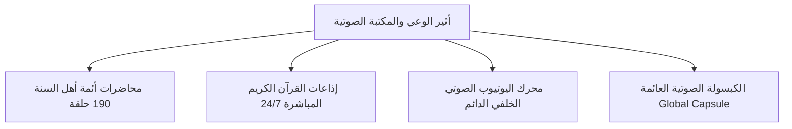
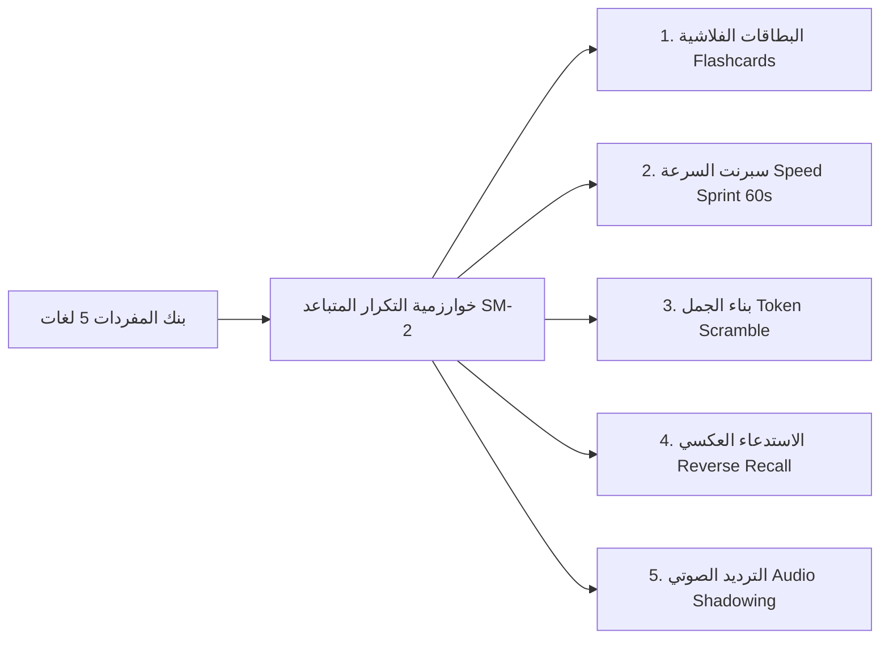

# 🌿 مِضمار | Midmar LifeOS
## الدليل الشامل والموسوعة المرجعية للمميزات والقدرات والمعمارية
> **"نظام تشغيل حياتي وإيماني متكامل، فائق الخصوصية والسيادة (Local-First)، يجمع بين ذروة الإنتاجية العصرية وأصالة اليقظة الروحية والفكرية."**

---

## 📑 فهرس المحتويات (Table of Contents)
1. [الرؤية والهدف والرسالة (Vision & Philosophy)](#1-الرؤية-والهدف-والرسالة-vision--philosophy)
2. [محطات اليوم التسع (The 9 Lifestyle Stations)](#2-محطات-اليوم-التسع-the-9-lifestyle-stations)
3. [الجناح الروحاني والإيماني الكامل (Spiritual & Faith Sanctuary)](#3-الجناح-الروحاني-والإيماني-الكامل-spiritual--faith-sanctuary)
4. [أثير الوعي والمكتبة الصوتية والقرآنية (Faith & Knowledge Audio Sanctuary)](#4-أثير-الوعي-والمكتبة-الصوتية-والقرآنية-faith--knowledge-audio-sanctuary)
5. [جناح الحكمة والأدب العربي الأصيل (Intellectual & Cultural Wisdom)](#5-جناح-الحكمة-والأدب-العربي-الأصيل-intellectual--cultural-wisdom)
6. [منظومة إتقان اللغات الأجنبية (CEFR Language Mastery Engine)](#6-منظومة-إتقان-اللغات-الأجنبية-cefr-language-mastery-engine)
7. [منصة العمل عالي التركيز وإدارة العلاقات (Workday Cockpit & Mini-CRM)](#7-منصة-العمل-عالي-التركيز-وإدارة-العلاقات-workday-cockpit--mini-crm)
8. [نظام التحفيز السلوكي ومكافآت الواقع (Behavioral Gamification & Real-Life Rewards)](#8-نظام-التحفيز-السلوكي-ومكافآت-الواقع-behavioral-gamification--real-life-rewards)
9. [البنية المعمارية والأمان الصارم والسيادة البيانية (Architecture & Security)](#9-البنية-المعمارية-والأمان-الصارم-والسيادة-البيانية-architecture--security)
10. [تجربة الاستخدام والأداء والتصميم العربي (Design System & Ergonomics)](#10-تجربة-الاستخدام-والأداء-والتصميم-العربي-design-system--ergonomics)
11. [بيانات الإطلاق والملكية والمستقبل (Ownership & Release Data)](#11-بيانات-الإطلاق-والملكية-والمستقبل-ownership--release-data)

---

## 1. الرؤية والهدف والرسالة (Vision & Philosophy)

### 🌿 ما هو "مضمار"؟
**المِضمار** في لسان العرب هو موضع تدريب الخيل وسباقها لإعدادها للغايات العظام. وفي هذا العصر الرقمي المتسارع المشحون بالمشتتات وفقدان البوصلة، يأتي **Midmar LifeOS** ليكون الميدان اليومي الشخصي الذي يصقل طاقة الإنسان، وينظم ساعاته، ويجمع بين:
1. **الإنتاجية العالية وإدارة العمل المتقدمة:** (سبرنتات التركيز، مصفوفة الأولويات، تنظيم المهام، وإدارة العملاء).
2. **الارتباط الإيماني والصفاء الروحي الخالص:** (الصلاة في وقتها، تدبر القرآن، الأذكار، النوافل، ومحاسبة النفس).
3. **الحصيلة الثقافية واللغوية الرفيعة:** (عيون الشعر العربي وبحوره الخليلية، النماذج العقلية، وإتقان اللغات الأجنبية بنظام التكرار المتباعد).

### 🛡️ مبدأ السيادة البيانية (Local-First Sovereignty)
- **بياناتك ملكك وحدك 100%:** التطبيق يعمل محلياً بالكامل على جهازك دون الحاجة لاتصال بالإنترنت، مستخدماً قاعدة بيانات `IndexedDB (Dexie.js)` المتطورة عبر 18 جدولاً مفهرساً.
- **صفر تتبع وخروج عن السحابة (Zero Telemetry):** لا يتم إرسال أي ملاحظات أو أهداف أو أذكار أو أسرار شخصية لأي طرف ثالث.
- **خادم مرافق اختياري:** للمزامنة المشفرة بين الأجهزة والنسخ الاحتياطي وحماية أوقات الصلاة عند الطلب.

---

## 2. محطات اليوم التسع (The 9 Lifestyle Stations)

تم تقسيم اليوم في مضمار إلى **9 محطات سلوكية مرنة** تراعي تدفق الطاقة الجسدية والنفسية، وتتوافق مع حركة الشمس وأوقات الصلوات:


### 1. المنصة الرئيسية (HOME - Cockpit Hub):
- واجهة القيادة الحية المتغيرة ديناميكياً حسب الوقت، تتضمن الإحصائيات اليومية، مؤشرات الطاقة والصلوات، وشريط التنقل السريع الخاطف (Quick-Jump Nav).
- بطاقة الموجه السلوكي الذكي (Smart Ambient Nudge & Behavioral Copilot).

### 2. انطلاق الصباح وتهيئة العقل (COMMUTE_MORNING):
- مخصصة للفترة الصباحية: استحضار النوايا، قراءة أذكار الصباح، الاستماع للدروس الإيمانية أثناء الطريق، وتحديد الأولويات الثلاث الكبرى لليوم (Big 3 Objectives).

### 3. سبرنت العمل عالي التركيز (WORK_MICRO_SPRINT):
- بيئة خالية تماماً من المشتتات، مؤقت سبرنتات عميقة (25 إلى 90 دقيقة)، مصفوفة آيزنهاور لتنظيم المهام، وأصوات نقية محيطية (White/Brown Noise، أمطار، غابات).
- مولد تقارير الستاند أب اليومي السريع (Agile Daily Standup).

### 4. حاجز الثواني الوقائي وتصفية الرغبة (ONE_SEC_FRICTION):
- نظام الحماية النفسية من الانتكاس أو فتح المواقع المشتتة: تفعيل وقفة تأملية إجبارية لعدة ثوانٍ مع تمرين التنفس والتفكير في عواقب التشتت (Urge Surfing).

### 5. الاستراحة الذكية المقيدة (SOCIAL_MEDIA_BREAK):
- استراحة محددة بوقت صارم تمنع التصفح اللانهائي (Infinite Scrolling)، وتذكر المستخدم بالهدف بعد انقضاء دقائق الراحة.

### 6. مرسى الرياضة والطاقة والنشاط (GYM_ANCHOR):
- تتبع النشاط البدني، التمارين الرياضية، وربط وقت التمرين بالاستماع للخطب والدروس الفكرية والإيمانية لجمع القوة البدنية مع الصفاء الروحي.

### 7. سبرنت المساء والإنهاء الإبداعي (EVENING_SPRINT):
- إغلاق المهام المفتوحة قبل غروب الشمس، مراجعة ما تم إنجازه، وتهدئة وتيرة العمل للتحول نحو وقت الأسرة والراحة.

### 8. المحاسبة والمراجعة المسائية (RETROSPECTIVE_CHECKIN):
- جلسة المحاسبة اليومية الشاملة: مراجعة الصلوات، الورد القرآني، الحصيلة اللغوية، تدوين تذكرة الفخر اليومية (Daily Pride Ticket)، وتسجيل الدروس المستفادة.

### 9. مكافأة الإنجاز والاسترخاء الليلي (GRAND_REWARD_STATE):
- ختام اليوم: فتح سلاسل الاستمرارية (Streaks)، صرف مكافآت الحياة الواقعية، قراءة سورة الملك المنجية من عذاب القبر، وبروتوكول الاستعداد لنوم هادئ ومبكر.

---

## 3. الجناح الروحاني والإيماني الكامل (Spiritual & Faith Sanctuary)

يعد الجناح الإيماني القلب النابض لمضمار، حيث تم تصميمه بدقة فقهية ورياضية فائقة:

### 🕌 أوقات الصلاة الدقيقة والأذان الحي
- **حساب دقيق 100% دون اتصال بالإنترنت:** يدعم كافة الهيئات الفقهية العالمية (أم القرى بمكة، الهيئة المصرية العامة للمساحة، جامعة العلوم الإسلامية بكراتشي، الاتحاد الإسلامي بأمريكا الشمالية ISNA، رابطة العالم الإسلامي، هيئات الخليج، وغيرها).
- **كشف تلقائي للموقع الجغرافي:** تحديد الإحداثيات وتعديل المواقيت تلقائياً.
- **تنبيهات الأذان بصوت ندي:** تشغيل الأذان كاملاً مع تنبيهات استباقية (قبل الأذان بـ 10 دقائق) للاستعداد للوضوء والتكبيرة الأولى.

### ☀️ الإيقاع الحيوي ومسار الـ 24 ساعة (Circadian Timeline)
- تمثيل بصري لحركة الشمس (الفجر، الشروق، الزوال، العصر، الغروب، الشفق، ثلث الليل، وجوف الليل الآخر) لمزامنة النشاط البشري مع الفطرة الكونية.

### 📖 متتبع ورد القرآن وحفظ الآيات المرن (Flexible Quran Suite)
- **مرونة مطلقة:** تحديد السورة، نطاق الآيات (من آية كذا إلى آية كذا)، وأرقام الصفحات الحالية والمستهدفة.
- **حاسبة الحسنات التقديرية:** حساب آلي للحسنات المتوقعة استناداً للحديث النبوي الشريف (الحرف بعشر حسنات) لتحفيز الهمة.
- **واجهة مستقلة ضد الأعطال:** معزولة بالكامل لضمان الإقلاع الفوري بدون شاشات سوداء.

### ✨ واحة الجمعة والبركة (Friday Barakah Sanctuary)
- تفعيل آلي يبدأ من عصر يوم الخميس حتى غروب شمس يوم الجمعة.
- متتبع وقارئ مخصص لـ **سورة الكهف**، مع عداد ذكي للصلاة على النبي ﷺ باهتزازات لمسية فاخرة.

### 📿 أذكار الصباح والمساء التفاعلية (Morning & Evening Adhkar)
- نصوص محققة ومشكولة بالكامل مع ذكر فضل كل ذكر ومصدره.
- عدادات تفاعلية مع شريط تقدم ذكي محمي رياضياً، وردود فعل لمسية وصوتية تحاكي المسبحة الواقعية.

### 🌟 دليل السنن والنوافل وصيام التطوع
- **قيام الليل والشفع والوتر:** إرشادات حساب الثلث الأخير وتحديد أفضل أوقات النزول الإلهي.
- **السنن الرواتب الاثنتا عشرة:** متابعة ركعات السنن القبلية والبعدية لبناء بيت في الجنة.
- **صلاة الضحى:** صلاة الأوابين وتتبع وقتها من بعد الشروق بربع ساعة حتى قبيل الزوال.
- **صيام الاثنين والخميس والأيام البيض (13، 14، 15 هجرياً):** تنبيهات استباقية ليلة الصيام لتبييت النية.

### 🔢 المسبحة الذكية ومحاسبة الاستغفار (Smart Tasbih Engine)
- صيغ متعددة: (سبحان الله، الحمد لله، الله أكبر، لا إله إلا الله، لا حول ولا قوة إلا بالله، الاستغفار، الصلاة على النبي).
- إمكانية تحديد أهداف رقمية مخصصة (33، 100، 1000) مع اهتزاز ملموس عند إتمام كل دورة.

### 🤲 متتبع قضاء الصلوات (Qadaa Tracker)
- سجل رقمي آمن لحساب ومتابعة قضاء الفوائت الصلوات المفروضة، مع توجيه وإحصائيات لتسديد الدين الإلهي بسلاسة ويسر.

### 💡 التدبر اليومي والحديث النبوي (Daily Tadabbur)
- آية يومية مختارة مصحوبة بلطائف التفسير والعمل بها، وحديث نبوي صحيح مع إضاءات لتطبيقه في الحياة المعاصرة.

---

## 4. أثير الوعي والمكتبة الصوتية والقرآنية (Faith & Knowledge Audio Sanctuary)

تعتبر المكتبة الصوتية في مضمار واحة فكرية كبرى موجهة لبناء العقل والروح:



### 📚 مكتبة كبار علماء وأئمة أهل السنة والجماعة
- **190 حلقة ومحاضرة موزعة على 59 سلسلة علمية موثقة بنسبة 100%:**
  - الإمام عبد العزيز بن باز رحمه الله.
  - الإمام محمد بن صالح العثيمين رحمه الله.
  - الإمام محمد ناصر الدين الألباني رحمه الله.
  - العلامة محمد الأمين الشنقيطي رحمه الله.
  - الشيخ عبد العزيز الطريفي.
  - الشيخ إبراهيم السكران.
  - الشيخ عبد الرزاق البدر.
  - الدكتور المهندس أيمن عبد الرحيم (دورات الوعي والتأسيس وتاريخ الحضارة).
  - الشيخ أحمد السيد (البناء الفكري، السيرة، أصول المصلحين).
  - الدكتور إياد قنيبي (رحلة اليقين وسلسلة المرأة).
  - الشيخ سمير مصطفى.
  - الشيخ خالد الراشد.
  - الشيخ عبد الحميد كشك رحمه الله.
  - الشيخ بدر المشاري.
  - الشيخ محمد سيد حاج رحمه الله.
  - الشيخ حازم شومان.
  - الشيخ عبد الله العجيري (برامج البوصلة الفكرية).
  - الدكتور أحمد عبد المنعم (تأسيس تدبر القرآن).
  - الدكتور هيثم طلعت.
  - المهندس أحمد العربي، والأستاذ أمجد سمير.

### 📻 إذاعات القرآن الكريم على مدار الساعة (Radio Sanctuary)
- بثوث حية عالية النقاء لمحطات إذاعة القرآن الكريم (القاهرة، مكة المكرمة، الرياض، نابلس، وغيرها).
- قنوات تلاوات خاشعة وتلاوات كبار القراء الخالدين (محمد صديق المنشاوي، عبد الباسط عبد الصمد، محمود خليل الحصري، مصطفى إسماعيل، محمود علي البنا).
- نظام ربط دقيق يضمن تشغيل القناة المطلوبة دون أي تداخل في العناوين أو الروابط.

### 🎧 مشغل اليوتيوب الصوتي الخفي الدائم (Persistent Background YouTube Host)
- محرك استماع صوتي يعمل في خلفية التطبيق في جذر النظام (`PersistentYouTubeHost`).
- **استماع متواصل لا ينقطع:** يتيح الاستماع للمحاضرات والدروس الطويلة دون انقطاع، حتى عند إغلاق النوافذ، أو تصفح المهام، أو التنقل بين المحطات المختلفة.
- حراسة تلقائية (`Audio Watchdog`) تمنع توقف الصوت أو التقطيع.

### 💊 الكبسولة الصوتية العائمة (Global Audio Capsule)
- كبسولة تحكم فاخرة تطفو أسفل الشاشة، تعرض اسم الدرس الحالي والشيخ، مع أزرار الإيقاف والتشغيل، تقديم وتأخير 15 ثانية، والتحكم في سرعة القراءة (0.75x إلى 2.0x).

---

## 5. جناح الحكمة والأدب العربي الأصيل (Intellectual & Cultural Wisdom)

### 📜 ديوان الشعر العربي والميزان العروضي (Classical Poetry & Arud)
- مختارات شعرية تمثل قمم الأدب العربي عبر العصور: (العصر الجاهلي، الأموي، العباسي، والأندلسي).
- شعر المتنبي، عنترة بن شداد، طرفة بن العبد، الشافعي، أبو فراس الحمداني، أبو تمام، ابن زيدون، حسان بن ثابت، والخنساء.
- **كاشف الأبحر الخليلية:** تعريف بالبحر العروضي لكل قصيدة (الطويل، البسيط، الكامل، الوافر، الخفيف، السريع، الرجز)، مع شرح الكلمات الغريبة واللفتات البلاغية.

### 🧠 خزانة النماذج العقلية والفكرية (Mental Models)
- نماذج التفكير الاستراتيجي المستقاة من علم النفس المعرفي والحكمة التراثية:
  - الأثر التراكمي (Compound Effect - التحسين بنسبة 1%).
  - تصفير الدوبامين واستعادة التركيز (Dopamine Reset).
  - إطار تقليل الندم (Regret Minimization Framework).
  - شفرة أوكام ومبدأ البساطة الفكرية.
  - إدارة الطاقة لا الوقت (Energy Management vs Time Management).

---

## 6. منظومة إتقان اللغات الأجنبية (CEFR Language Mastery Engine)

نظام متكامل لاكتساب الحصيلة اللغوية اليومية بطرق علمية مجربة:



### 🌍 اللغات المدعومة والتصنيف الأوروبي الموحد (CEFR)
- يدعم 5 لغات عالمية: **الإنجليزية، الفرنسية، الألمانية، الإيطالية، والإسبانية**.
- تصنيف المفردات بدقة وفق المستويات الستة: `A1, A2, B1, B2, C1, C2`.

### ⚡ خوارزمية التكرار المتباعد (Spaced Repetition SM-2)
- جدولة مراجعة الكلمات وفق استجابة الذاكرة (معدل السهولة Ease Factor، الفاصل الزمني Interval، وعدد التكرارات).
- حماية تقدم الحفظ محلياً عبر قاعدة بيانات Dexie.

### 🎮 حركات وتمارين التثبيت الخمس (5 Learning Moves)
1. **قلب البطاقات التفاعلية (Flashcard Flip):** للاستعراض السريع وسماع النطق.
2. **سبرنت السرعة الخاطف (Speed Sprint 60s):** اختبار الاسترجاع السريع تحت ضغط المؤقت.
3. **تجميع الرموز وبناء الجمل (Token Scramble):** ترتيب الكلمات لبناء التراكيب اللغوية الصحيحة.
4. **الاستدعاء العكسي (Reverse Recall):** التحدي بالترجمة من اللغة الأم إلى اللغة الهدف.
5. **المحاكاة والترديد الصوتي (Speech Shadowing):** الاستماع للنطق البشري عبر محرك `Web Speech API` والترديد المباشر.

### 📥 مستورد الحزم المخصصة (Custom Deck Importer)
- استيراد بطاقات ومفردات خارجية من صيغ `CSV`, `JSON`, وبطاقات `Anki`.
- حماية أمنية تلقائية ضد ثغرات الحقن وتطهير المحتوى عبر مكتبة `DOMPurify`.

---

## 7. منصة العمل عالي التركيز وإدارة العلاقات (Workday Cockpit & Mini-CRM)

### 🎯 مصفوفة آيزنهاور للأولويات (Eisenhower Decision Matrix)
- تصنيف رباعي مرن للمهام:
  1. **عاجل ومهم:** إنجاز فوري.
  2. **غير عاجل ولكنه مهم:** جدولة في سبرنتات العمل.
  3. **عاجل وغير مهم:** تفويض أو أتمتة.
  4. **غير عاجل وغير مهم:** حذف فوري لتصفية الذهن.

### ⏱️ مؤقت سبرنتات العمل العميق (Micro-Sprint Timer)
- جلسات قابلة للتخصيص (25، 45، 60، 90 دقيقة) مستوحاة من منهجية البومودورو وإيقاع التركيز العصبي الفائق (Ultradian Rhythms).
- مؤثرات صوتية لنهاية السبرنت ورسائل تشجيعية عند كسر حواجز التسويف.

### 📋 مولد تقارير الستاند أب السريع (Agile Daily Standup Generator)
- ضغطة زر واحدة لتوليد تقرير احترافي عن: (ما تم إنجازه اليوم، المهام الجاري العمل عليها، المعوقات، والخطوات القادمة) جاهز للنسخ إلى Slack أو WhatsApp أو Teams.

### 💼 إدارة العملاء الخفيفة ومراسلات الوصول (Mini-CRM & Outreach)
- خط أنابيب بسيط لإدارة العلاقات والعملاء المحتملين: (عميل محتمل Prospect، تم التواصل Contacted، قيد التفاوض In Discussion، تم التعاقد Closed/Won).
- قوالب جاهزة للرسائل والتواصل الاحترافي السريع.

### 🛡️ درع التقويم وحماية أوقات الصلاة (Calendar Prayer Shield)
- استيراد ملفات التقويم `ICS/CalDAV` لمزامنة المواعيد.
- **درع الصلاة:** فحص تلقائي لكشف أي تعارض بين مواعيد الاجتماعات وأوقات الصلوات، وتحذير المستخدم بتقديم أو تأخير الموعد لحماية الفريضة.

---

## 8. نظام التحفيز السلوكي ومكافآت الواقع (Behavioral Gamification & Real-Life Rewards)

### 🔥 سلاسل الاستمرارية ودروع التجميد (Streaks & Freeze Shields)
- عداد يومي لسلاسل الالتزام بالمحطات والصلوات.
- دروع تجميد تحمي السلسلة من الانكسار في حالات السفر أو المرض الطارئ.

### 🎁 خزانة مكافآت الحياة الواقعية (Real-Life Rewards Locker)
- لا تكتفي بالنقاط الرقمية، بل تربط الإنجاز بمكافآت ملموسة في الواقع (قهوة فاخرة، جلسة قراءة هادئة، نزهة في الطبيعة، شراء كتاب جديد) تفتح تلقائياً عند تجاوز نقاط محددة.

### 🛡️ وضع النجاة والطاقة المنخفضة (Survival Mode)
- زر استثنائي مخصص لأيام الإرهاق الشديد أو المرض: يخفض سقف الأهداف تلقائياً إلى الضروريات غير القابلة للتفاوض (الصلوات المفروضة والراحة التامة) مع حماية السلسلة اليومية من الفقدان.

### 🎫 تذكرة الفخر اليومية (Daily Pride Ticket)
- تدوين مكثف للإنجاز الأهم في اليوم لاستشعار الامتنان وبناء الصورة الذاتية الإيجابية قبل النوم.

### 📊 تقرير البركة الأسبوعي (Weekly Barakah Report)
- مراجعة بيانية دقيقة في ختام كل أسبوع ترصد ساعات التركيز، نسب إتمام الصلوات، الكلمات المكتسبة، ومحطات اليوم المحققة.

---

## 9. البنية المعمارية والأمان الصارم والسيادة البيانية (Architecture & Security)

```text
┌──────────────────────────────────────────────────────────────┐
│                    MIDMAR CLIENT (React 19)                  │
│  Tailwind v4 • Dexie IndexedDB (18 Tables) • Web Audio API   │
│       Local Intelligence Engine • Persistent YouTube Host    │
└──────────────────────────────┬───────────────────────────────┘
                               │ (TLS / Bearer Secret)
                               ▼
┌──────────────────────────────────────────────────────────────┐
│                  COMPANION BACKEND (Node.js)                 │
│      Timing-Safe Auth • Sliding-Window Rate Limiters         │
│     Encrypted Sync / Delta Protocol • PostgreSQL / SQLite    │
└──────────────────────────────────────────────────────────────┘
```

### 🔒 حصر صلاحية المالك (Exclusive Owner Architecture)
- رتبة **المالك (Owner)** محصورة حصرياً ودائماً في **أحمد (`AhmadZohery@gmail.com`)**.
- أي تسجيل جديد عبر المتصفح أو أي جهاز غريب يُعامل تلقائياً كمستخدم عادي (`user`) بدون أي صلاحيات تصعيد أو إمكانية التحكم في خيارات المالك أو الاطلاع على سجلاته.

### 🛡️ التشفير والحماية ضد هجمات التوقيت (Constant-Time Crypto)
- تشفير كلمات المرور باستخدام `PBKDF2` مع ملح فريد (Salt) وتكرارات أمنية قياسية.
- مقارنة التوكن ورموز الـ PIN عبر خوارزميات التوقيت الثابت (`crypto.timingSafeEqual` و `constantTimeCompare`) لمنع هجمات التحليل الزمني الجانبية (Timing Side-Channel Attacks).

### 🚦 حماية المداخل بمحددات المعدل (Sliding-Window Rate Limiters)
- حماية مسارات تسجيل الدخول والمزامنة والذكاء الاصطناعي بمحددات معدل طلبات تمنع هجمات التخمين العنيف (Brute Force) وهجمات حجب الخدمة (DoS).

### 📦 الجاهزية للعمل كـ PWA وتطبيق هاتف مستقل
- ملف `manifest.json` وأيقونة متجهة متوافقة مع شاشات Android و iOS Maskable Squircle.
- كاش الخدمة عبر `Service Worker (public/sw.js)` للعمل بكفاءة 100% في وضع الطيران وبدون شبكة.

---

## 10. تجربة الاستخدام والأداء والتصميم العربي (Design System & Ergonomics)

### 💎 الهوية البصرية: الزمرد الأوبسيدي مع لمسات الذهب
- تصميم داكن فخم يعتمد على تدرجات الزمرد الداكن العميق (`#031e17`, `#041d17`, `#0c1f1a`) لمنع إجهاد العين ليلاً.
- لمسات ذهبية ملكية (`#f59e0b`, `#fbbf24`) للتنبيهات وعلامات الإنجاز الفاخرة.

### ✍️ أصالة الخط العربي وعلامات المصحف
- التزام كامل بمعايير الخط العربي: سقف أوزان الخطوط لا يتجاوز 700 لمنع التشويه، وارتفاع أسطر مريح يتجاوز 2.2 للآيات القرآنية لمنع تداخل حركات التشكيل.
- توافق كامل مع اتجاه الكتابة من اليمين لليسار (RTL First) مع اتجاهات صحيحة للأيقونات والأسهم.

### ⚡ أداء فائق 60 إطاراً في الثانية على الموبايل
- دمج خاصية `[content-visibility: auto]` لتفادي معالجة وتصيير الأقسام الواقعة خارج شاشة الهاتف، مما يمنع التقطيع (Stuttering).
- **شريط الفلترة الخاطف (Mobile Quick-Jump Nav):** إمكانية إظهار كل قسم على حدة (الصلوات، الحكمة، الرياضة، اللغات، الإيقاع الحيوي) بنقرة واحدة للتخلص نهائياً من عناء التمرير الطويل على شاشات الموبايل.

---

## 11. بيانات الإطلاق والملكية والمستقبل (Ownership & Release Data)

- **اسم المنتج:** مِضمار | Midmar LifeOS
- **الإصدار الحالي:** v2.0 (Production Stable - 100% Validated)
- **المطور والمالك الحصري:** أحمد (Ahmad) — `AhmadZohery@gmail.com`
- **حالة الاختبارات والتحقق:**
  - Strict TypeScript Typecheck: `0 errors`
  - Oxlint Fast Linter: `0 errors`
  - Vitest Test Suite: `69/69 tests passed`
  - Pre-Deployment Verification Gates: `7/7 Gates Passed`
- **المسار المستقبلي المرصود (Product Evolution Pack):**
  - `OPP-0101`: Multi-Device Conflict-Free Delta Sync Engine.
  - `OPP-0102`: In-Browser WebAssembly Quran Recitation & Tajweed Helper.
  - `OPP-0103`: Dynamic CEFR Custom Deck & CSV/JSON Importer.
  - `OPP-0104`: External Calendar Bridge (ICS/CalDAV) with Prayer Shield.

---
*تم إنشاء وتدقيق هذا الدليل ليكون المرجع الشامل والنهائي لكافة إمكانيات ومميزات نظام مضمار.* 🌿⚡
